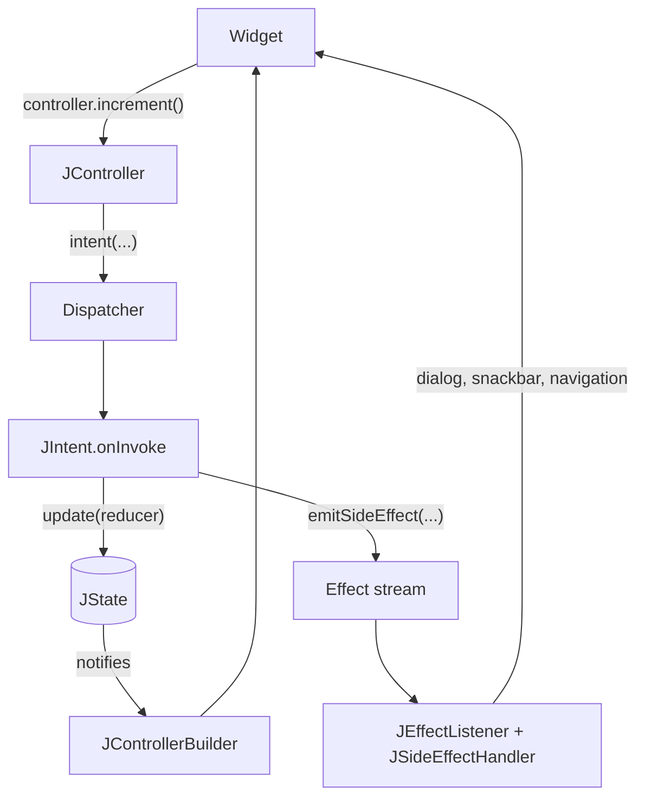
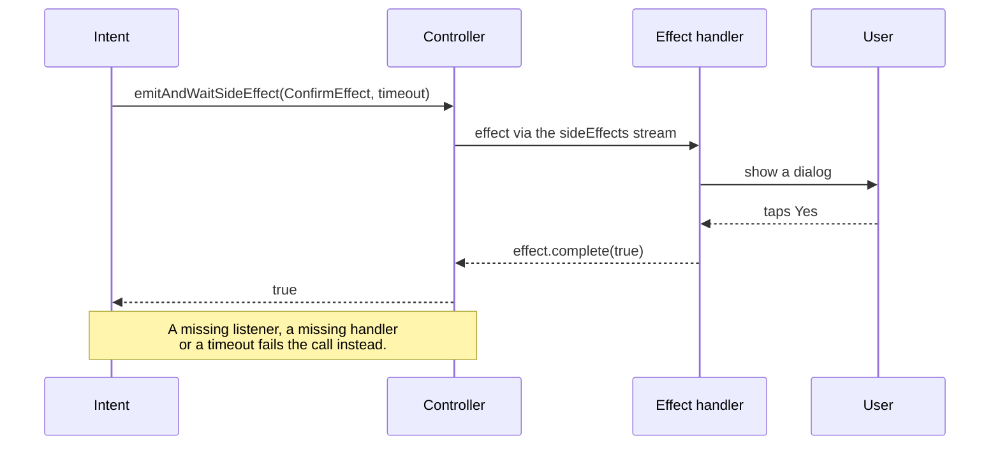
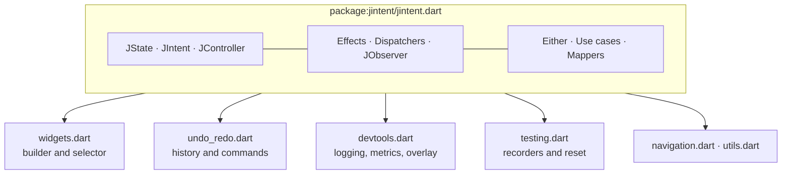

JIntent applies an MVI-inspired flow: the UI asks a **controller** to do something, the controller runs a named **intent**, the intent updates immutable **state**, and the UI rebuilds from it. Anything transient (a dialog, a snackbar, a navigation) leaves through a separate **effect** stream instead of living in state.

## The loop

| Piece | Responsibility |
| --- | --- |
| `JState` | Immutable data compared by value. An update equal to the current state is skipped. |
| `JIntent` | One awaitable operation. It reads and updates state and may emit effects. |
| `JController` | Owns the state and dispatches intents. It is a `StateNotifier`. |
| Dispatcher | Decides how overlapping intents run: in order, concurrently, dropped or restarted. See [concurrency](/JIntent/guides/concurrency/). |
| `JEffect` | A transient UI event, kept out of persistent state. |
| `JSideEffectHandler` | Maps each concrete effect type to the UI that presents it. |

## An effect that waits for the UI

Awaited effects let an intent ask the UI a question and continue with the answer. The *Startup & effects* [demo](/JIntent/demos/effects/) runs exactly this flow.

## Layers and entry points

The core is deliberately small. Domain helpers are optional and the application owns persistence, networking and navigation. Optional features live in their own entry points so you only import what you use.

The reasoning behind these boundaries is recorded in the [architecture records](/JIntent/adr/).

## Where to go next

- Run the loop yourself in the [Counter demo](/JIntent/demos/counter/).
- See how overlapping intents behave in the [Concurrency Lab](/JIntent/demos/concurrency/).
- Read the [effects guide](/JIntent/guides/effects/) for failures, timeouts and buffering.
