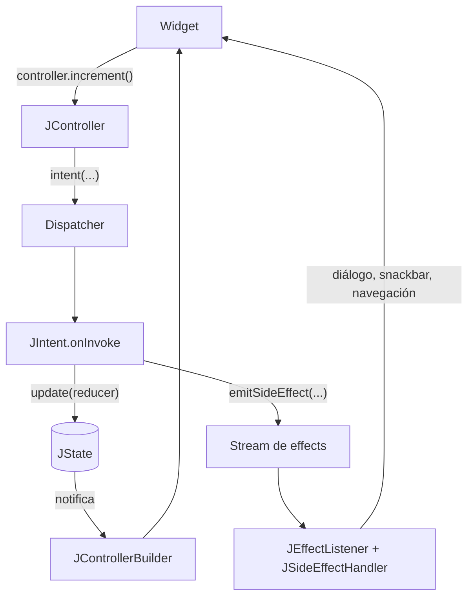
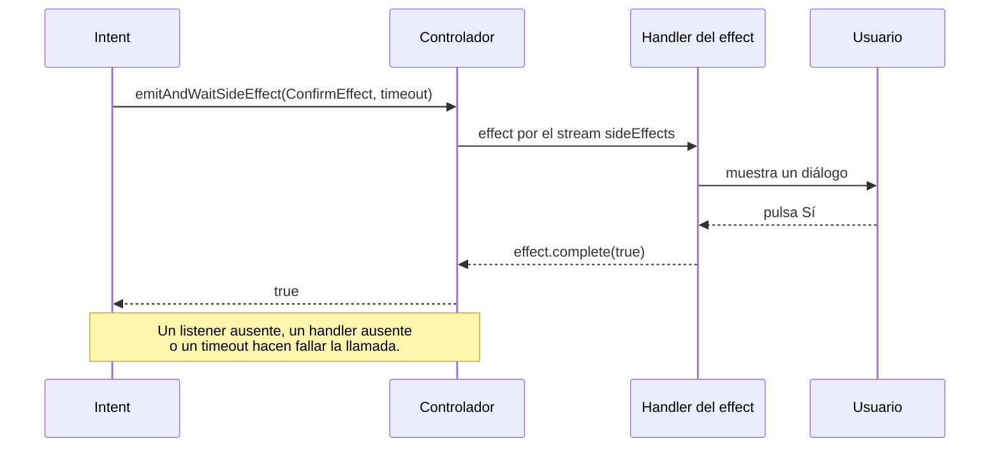
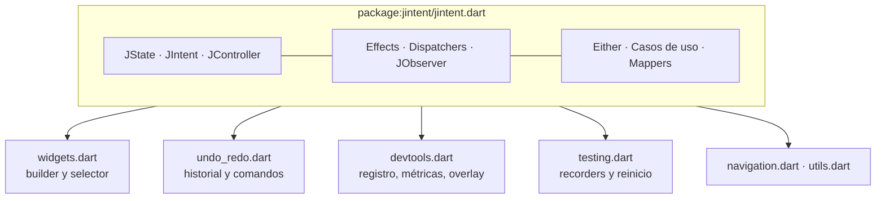

JIntent aplica un flujo de inspiración MVI: la UI le pide algo a un **controlador**, el controlador ejecuta un **intent** con nombre, el intent actualiza el **estado** inmutable y la UI se reconstruye a partir de él. Todo lo transitorio (un diálogo, un snackbar, una navegación) sale por un stream de **effects** separado en lugar de vivir en el estado.

## El ciclo

| Pieza | Responsabilidad |
| --- | --- |
| `JState` | Datos inmutables comparados por valor. Una actualización igual al estado actual se omite. |
| `JIntent` | Una operación awaitable. Lee y actualiza el estado y puede emitir effects. |
| `JController` | Es dueño del estado y despacha los intents. Es un `StateNotifier`. |
| Dispatcher | Decide cómo se ejecutan los intents que se solapan: en orden, de forma concurrente, descartados o reiniciados. Consulta [concurrencia](/JIntent/es/guides/concurrency/). |
| `JEffect` | Un evento de UI transitorio, fuera del estado persistente. |
| `JSideEffectHandler` | Asocia cada tipo concreto de effect con la UI que lo presenta. |

## Un effect que espera a la UI

Los effects esperables permiten que un intent le haga una pregunta a la UI y continúe con la respuesta. La [demo](/JIntent/es/demos/effects/) *Arranque y effects* ejecuta exactamente este flujo.

## Capas y puntos de entrada

El núcleo es deliberadamente pequeño. Los helpers de dominio son opcionales y la aplicación es dueña de la persistencia, la red y la navegación. Las funciones opcionales viven en sus propios puntos de entrada para que importes solo lo que usas.

El razonamiento detrás de estos límites está recogido en los [registros de arquitectura](/JIntent/es/adr/).

## A dónde ir después

- Recorre el ciclo tú mismo en la [demo del contador](/JIntent/es/demos/counter/).
- Mira cómo se comportan los intents que se solapan en el [laboratorio de concurrencia](/JIntent/es/demos/concurrency/).
- Lee la [guía de effects](/JIntent/es/guides/effects/) para fallos, timeouts y búfer.
